# WBOZYA-dash — аналитика продаж на Wildberries и Ozon


Система аналитики для селлеров Wildberries и Ozon: ETL-скрипты на Python забирают данные из API маркетплейсов и Google Sheets, складывают их в PostgreSQL, а дашборды DataLens строятся поверх базы SQL-запросами.

Проект вырос из первого коммерческого заказа: у клиента учет продаж жил в двух десятках Google-таблиц по 20–30 листов, без документации. Вместо того чтобы разбирать эти таблицы, я сделал новую систему, а старые таблицы использовал только для сверки итоговых цифр. Система работает на VPS или в Яндекс.Облаке.

> В репозитории только описание проекта. Исходный код ETL-скриптов и экспорт проекта DataLens не публикуются.

**[Демо дашборда в DataLens](https://datalens.yandex/5lkk5iqa9alsq)**: реальные продажи на WB и Ozon за сентябрь 2025 года, артикулы изменены.

## Содержание

- [Технологический стек](#технологический-стек)
- [Архитектура](#архитектура)
- [Опрашиваемые методы API](#опрашиваемые-методы-api)
- [Обработка ошибок и лимитов API (429)](#обработка-ошибок-и-лимитов-api-429)
- [UPSERT на стороне PostgreSQL](#upsert-на-стороне-postgresql)
- [База данных в цифрах](#база-данных-в-цифрах)
- [Дашборды DataLens в цифрах](#дашборды-datalens-в-цифрах)
- [Скриншоты](#скриншоты)

## Технологический стек

| Слой | Технологии |
| --- | --- |
| Сбор данных (ETL) | Python 3, `requests`, `pandas`, `numpy`, Google API Client (Sheets v4), `hashlib` (MD5) |
| Запуск | cron на VPS или таймер Cloud Functions в Яндекс.Облаке; ручной запуск отдельных процедур через параметры командной строки |
| Хранилище | PostgreSQL 16, `psycopg2` (`execute_values`, `copy_from`), временные таблицы, хранимые процедуры, представления и материализованное представление |
| Витрины | OLAP-таблицы «по дням», которые пересчитываются хранимыми процедурами после каждой загрузки |
| BI | Yandex DataLens: QL-чарты на SQL с параметрами, wizard-чарты на датасетах, селекторы, карты |
| Мониторинг | журнал ETL в таблице `log`, отчет о прогоне в Telegram-бот, проверки целостности БД (`db_check`), технические вкладки на дашборде |

Объем кода: около 7,6 тыс. строк Python в ETL-скриптах (общая библиотека и по одному скрипту на WB, Ozon, рекламу Ozon и Google Sheets), 2,2 тыс. строк DDL и около 14 тыс. строк SQL в чартах DataLens.

## Архитектура

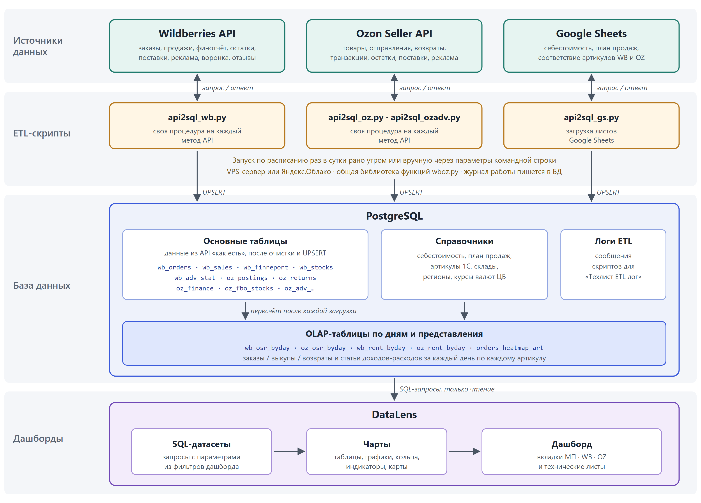

Система состоит из трех частей, которые работают как единое целое:

- **ETL-скрипты на Python.** На каждый метод API приходится своя процедура. В штатном режиме скрипты запускаются раз в сутки рано утром. Каждая процедура смотрит, какие самые свежие данные уже лежат в БД, и запрашивает API с этой даты включительно по текущий момент. Поэтому после сбоя данные догружаются без пропусков, и вручную ничего восстанавливать не нужно. Есть и процедуры-оркестраторы, которые запускают весь список методов «одной кнопкой».
- **База данных PostgreSQL.** Основные таблицы хранят данные из API «как есть», без пересчета часовых поясов и коэффициентов. Рядом лежат справочники (себестоимость, план продаж, соответствие артикулов WB/OZ/1С, склады, регионы, курсы валют ЦБ), журнал ETL и OLAP-таблицы. OLAP-таблицы содержат готовые агрегаты по дням и артикулам и пересчитываются после каждой загрузки за последние несколько дней.
- **DataLens.** С API напрямую не связан, только читает данные из БД. Большинство чартов построено на SQL-запросах, потому что метрикам нужны многоэтапные агрегации, которые вычисляемые поля DataLens не умеют.

Многие методы API отдают сумму за период. Такие методы опрашиваются в цикле по одному дню, чтобы в базе всегда лежали данные «за каждый день» и дашборд мог собрать любой период простым суммированием. Методы, которые отдают снимок «на сейчас» (остатки на складах), дополнительно архивируются в `*_histr`-таблицы с датой опроса.

## Опрашиваемые методы API

### Wildberries

| Процедура | Метод API | Таблица |
| --- | --- | --- |
| `etl_wb_cards` | `content-api` `POST /content/v2/get/cards/list` | `wb_cards` |
| `etl_wb_orders` | `statistics-api` `GET /api/v1/supplier/orders` | `wb_orders` |
| `etl_wb_sales` | `statistics-api` `GET /api/v1/supplier/sales` | `wb_sales` |
| `etl_wb_finreport` | `finance-api` `POST /api/finance/v1/sales-reports/detailed` | `wb_finreport` |
| `etl_wb_stocks` | `seller-analytics-api` `POST /api/analytics/v1/stocks-report/wb-warehouses` | `wb_stocks`, `wb_stocks_histr` |
| `etl_wb_plan_incomes` | `supplies-api` `/api/v1/supplies`, `/api/v1/supplies/{id}/goods` | `wb_incomeplan_prod` |
| `etl_wb_adv_expenses` | `advert-api` `GET /adv/v1/upd` | `wb_adv_expenses` |
| `etl_wb_adv_stat` | `advert-api` `/adv/v3/fullstats` | `wb_adv_stat` |
| `etl_wb_feedback` | `feedbacks-api` `GET /api/v1/feedbacks` | `wb_feedback` |
| `etl_wb_voronka_csv` | `seller-analytics-api` `/api/v2/nm-report/downloads` (асинхронный отчет: создать → дождаться → скачать CSV) | `wb_voronka_csv` |
| `etl_wb_voronka` | `seller-analytics-api` `POST /api/analytics/v3/sales-funnel/products` | `wb_voronka_csv` |
| `etl_wb_searchtext` | `seller-analytics-api` `/api/v2/nm-report/downloads` (отчет по поисковым запросам) | `wb_searchtext` |

### Ozon Seller API

| Процедура | Метод API | Таблица |
| --- | --- | --- |
| `etl_oz_products` | `/v1/report/products/create` → `/v1/report/info` (асинхронный отчет) | `oz_products` |
| `etl_oz_postings` | `/v1/report/postings/create` → `/v1/report/info` (асинхронный отчет) | `oz_postings` |
| `etl_oz_fbolist` | `/v3/posting/fbo/list` | `oz_fbolist` |
| `etl_oz_fbslist` | `/v4/posting/fbs/list` | `oz_fbslist` |
| `etl_oz_check_frozen_postings` | `/v2/posting/fbo/get`, `/v3/posting/fbs/get` (дозапрос «зависших» отправлений) | `oz_fbolist`, `oz_fbslist` |
| `etl_oz_returns` | `/v1/returns/list` | `oz_returns` |
| `etl_oz_finance` | `/v1/finance/accrual/types`, `/v1/finance/accrual/by-day` | `oz_finance`, `oz_finance_dict` |
| `etl_oz_stocks` | `/v1/analytics/stocks` | `oz_fbo_stocks`, `oz_fbo_stocks_histr` |
| `etl_oz_onwarehouse` | `/v1/product/info/stocks-by-warehouse/fbo` | `oz_onwarehouse`, `oz_onwarehouse_histr` |
| `etl_oz_warehouse_list` | `/v1/cluster/list` | `oz_warehouse_list` |
| `etl_oz_incomes` | `/v3/supply-order/list` → `/v3/supply-order/get` → `/v1/supply-order/bundle` | `oz_incomes`, `oz_incomeplan_prod` |
| `etl_oz_feedback` | `/v1/seller/info`, `/v1/review/list` | `oz_feedback` |
| `elt_oz_discounts` | `/v1/actions/discounts-task/list` | `oz_discounts` |
| `etl_oz_prod_actions` | `/v1/actions`, `/v1/actions/products` | `oz_prod_actions` |
| `etl_oz_analytics` | `/v1/analytics/data` | `oz_analytics_data` |
| `etl_oz_searchtext` | `/v1/analytics/product-queries/details` | `oz_searchtext` |
| `etl_oz_prices` | `/v5/product/info/prices` | `oz_prices` |

### Ozon Performance API (реклама)

Доступ идет по временному токену, который скрипт сам получает перед опросом.

| Процедура | Метод API | Таблица |
| --- | --- | --- |
| `etl_ozadv_campaign` | `/api/client/campaign`, `/api/client/campaign/{id}/objects` | `oz_adv_campign` |
| `etl_ozadv_expenses` | `/api/client/statistics/daily/json`, `/api/client/statistics/expense/json` | `oz_adv_expenses` |
| `etl_ozadv_orders` | `/api/client/statistic/orders/generate` → `/api/client/statistics/{uuid}` → скачивание отчета | `oz_adv_orders` |
| `etl_ozadv_clicks` | `/api/client/statistics/campaign/product/json` | `oz_adv_clicks` |
| `etl_ozadv_stat_bysku` | `/api/client/statistics/json` → `/api/client/statistics/{uuid}` → скачивание отчета | `oz_adv_statbysku` |
| `etl_ozadv_faststat` | `/api/client/statistics/products/sku` | `oz_adv_faststat` |

### Прочие источники

| Процедура | Источник | Таблица |
| --- | --- | --- |
| `etl_oz_currency` | ЦБ РФ, `XML_daily.asp` (курсы валют на дату) | `currency` |
| `elt_gs_costprice_wb`, `elt_gs_costprice_oz` | Google Sheets API v4: себестоимость | `gs_costprice_wb`, `gs_costprice_oz` |
| `elt_gs_1c_articul` | Google Sheets API v4: соответствие артикулов 1С, WB и OZ | `gs_art_1c` |
| `elt_gs_plan` | Google Sheets API v4: план продаж | `gs_plan` |

Итого 40 процедур ETL. Многие запросы проходят в 2–3 шага: сначала заказывается отчет, потом скрипт ждет его готовности и скачивает файл, либо данные из первого ответа служат параметрами для второго запроса.

## Обработка ошибок и лимитов API (429)

У API маркетплейсов жесткие лимиты на число запросов в единицу времени и на объем одного ответа, поэтому основную часть времени скрипт проводит в паузах. Все запросы идут через одну универсальную функцию `get_api(url, heads, params, pg, max_retries, timeout)`, и в ней же собрана вся логика повторов:

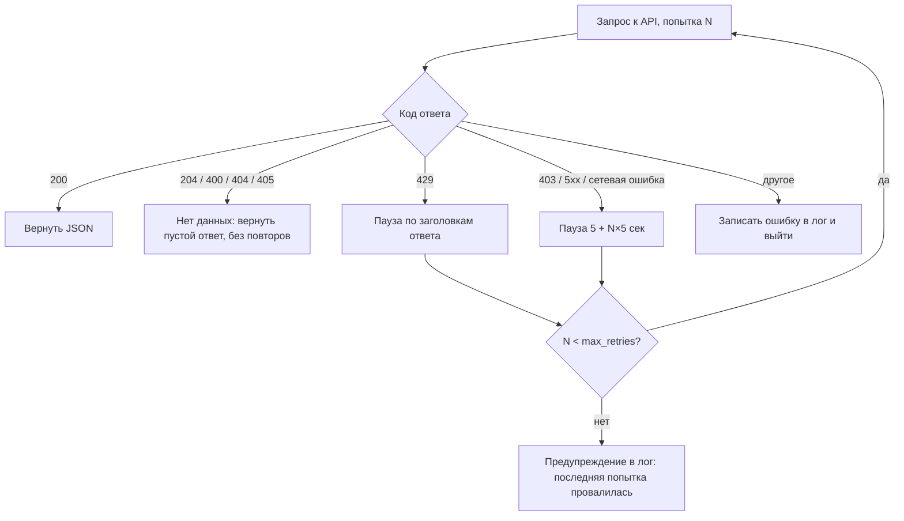

Как считается пауза при **429 Too Many Requests**:

1. Базовая пауза растет с номером попытки: `5 + N × 5` секунд.
2. Если в ответе **Wildberries** есть заголовок `X-Ratelimit-Retry` (через сколько секунд можно повторить), пауза равна `X-Ratelimit-Retry + 5`.
3. Если в ответе **Ozon** есть заголовок `Retry-After` больше 5 секунд, пауза равна `Retry-After + 5`.
4. Если есть `X-Ratelimit-Reset` (время полного восстановления лимита), он пишется в лог для диагностики.
5. Пауза ограничена сверху 120 секундами, после нее запрос повторяется. Число попыток задается при вызове, обычно 5–10.

Код 403 обрабатывается так же, как 5xx: на рекламных методах Ozon он часто бывает временным. Коды 204/400/404 означают «данных нет», это нормальный ответ, и повторять запрос бессмысленно.

Защита работает и на уровне выше одного запроса:

- **Каждая порция данных сохраняется сразу.** Постраничные и подневные циклы записывают в БД каждую полученную страницу, не дожидаясь конца цикла. Если API отвалится на середине, уже загруженное не пропадет.
- **Изоляция процедур.** Оркестратор `*_update_all` запускает каждую процедуру в своем `try/except`. Ошибка в одном методе не останавливает остальные, а итоговый отчет `OK/ERR` по каждой процедуре уходит в Telegram.
- **Перезапуск до успеха.** `*_update_untilok` запускается по cron раз в час с 3 до 10 утра. Он читает из таблицы `log`, как завершился последний запуск каждой процедуры сегодня, и перезапускает только те, что не завершились успешно.
- **Догрузка с последней даты.** Дата начала запроса берется из БД (максимальная загруженная дата, при необходимости со сдвигом назад), поэтому пропущенные дни подтягиваются при следующем запуске.

## UPSERT на стороне PostgreSQL

Скрипт не выясняет, какие строки уже лежат в базе: он отправляет весь свежий массив, а PostgreSQL сам разбирается, что вставить, что обновить и что пропустить. Для этого к каждой строке добавляются два MD5-хеша:

| Колонка | Как считается | Назначение |
| --- | --- | --- |
| `idx_hash` | MD5 от ключевых колонок таблицы, например `srid + nmid + partner` для `wb_orders` | Уникальный ключ строки (`UNIQUE INDEX`) |
| `data_hash` | MD5 от всех остальных колонок | «Слепок» данных строки |
| `last_updated` | Время загрузки | Когда строка последний раз менялась |

Набор ключевых колонок задается для каждой таблицы словарем. Таблицы без ключа (журналы, справочники) пишутся простым `INSERT ... ON CONFLICT DO NOTHING`.

```sql
INSERT INTO wb_orders (idx_hash, data_hash, last_updated, ...)
VALUES %s
ON CONFLICT (idx_hash)
DO UPDATE SET data_hash = EXCLUDED.data_hash, last_updated = EXCLUDED.last_updated, ...
WHERE wb_orders.data_hash IS DISTINCT FROM EXCLUDED.data_hash
RETURNING (xmax = 0);
```

- Строки с новым `idx_hash` вставляются.
- Строки с существующим `idx_hash` и другим `data_hash` обновляются.
- Строки, в которых ничего не изменилось, не трогаются: условие `WHERE` отсекает пустые UPDATE, поэтому таблица не пухнет от лишних версий строк.
- `RETURNING (xmax = 0)` отличает вставленные строки (`true`) от обновленных (`false`). После каждой записи в лог уходит статистика вида `+120 новых, ~15 обновлено, =3400 без изменений`.

Для больших объемов (больше 1000 строк) включается быстрый путь:

1. Датафрейм выгружается во временный CSV.
2. `CREATE TEMP TABLE tmp_<hash> (LIKE <table> INCLUDING ALL)` создает временную таблицу.
3. `COPY` (через `psycopg2.copy_from`) заливает CSV во временную таблицу.
4. `INSERT INTO <table> SELECT ... FROM tmp_<hash> ON CONFLICT (idx_hash) DO UPDATE ... WHERE data_hash IS DISTINCT FROM ...` переносит данные в рабочую таблицу.

Этот путь требует точного совпадения типов и порядка колонок с рабочей таблицей. За это отвечает отдельная функция `check_col_dtypes`: по `INFORMATION_SCHEMA.COLUMNS` она приводит датасет к типам и порядку колонок таблицы, чистит строки от спецсимволов и добавляет недостающие колонки.

## База данных в цифрах

| Показатель | Значение |
| --- | --- |
| Таблиц | **55** |
| Полей во всех таблицах | **933** |
| Таблиц с хеш-UPSERT (`idx_hash` / `data_hash`) | 45 |
| Индексов | 108 (в том числе уникальный индекс по `idx_hash` на каждой UPSERT-таблице) |
| Представлений | 3 + 1 материализованное (когорты Ozon по неделям) |
| Хранимых процедур | 4 (пересчет OLAP-таблиц) |
| Самая «широкая» таблица | `wb_finreport`, 94 поля (детальный финансовый отчет WB) |

Распределение таблиц:

| Группа | Таблиц | Примеры |
| --- | --- | --- |
| Wildberries | 17 | `wb_orders`, `wb_sales`, `wb_finreport`, `wb_stocks`, `wb_adv_stat`, `wb_voronka_csv` |
| Ozon (включая рекламу) | 30 | `oz_postings`, `oz_returns`, `oz_finance`, `oz_fbo_stocks`, `oz_prices`, `oz_adv_*` |
| Google Sheets | 4 | `gs_costprice_wb`, `gs_costprice_oz`, `gs_art_1c`, `gs_plan` |
| Служебные и справочные | 4 | `log`, `db_check`, `currency`, `rus_reg_borders` |

В том числе 4 OLAP-таблицы (`wb_osr_byday`, `oz_osr_byday`, `wb_rent_byday`, `oz_rent_byday`), 3 архивные `*_histr` для снимков остатков и справочники координат складов для карт.

OLAP-таблицы хранят заказы, выкупы, возвраты и статьи доходов и расходов за каждый день по каждому артикулу. Хранимые процедуры `*_osr_olap_update` и `*_rent_olap_update` пересчитывают их после каждой загрузки, поэтому вкладки сводной аналитики быстро открываются даже на длинных периодах.

## Дашборды DataLens в цифрах

| Показатель | Значение |
| --- | --- |
| Вкладок | **41**: 5 сводных по маркетплейсам, 16 WB, 15 Ozon, 1 «О дашборде», 4 технических |
| Чартов | **142** |
| из них QL-чартов на SQL | 116, около 14 тыс. строк SQL |
| из них wizard-чартов на датасетах | 26 |
| Датасетов | 23 (11 на SQL-подзапросах, 12 на таблицах и представлениях) |
| Селекторов | 203 в 39 группах |

Типы визуализаций:

| Тип | Кол-во |
| --- | --- |
| Таблица | 67 |
| График (линии) | 27 |
| Индикатор | 25 |
| Кольцевая диаграмма | 10 |
| Столбчатая / нормированная | 4 |
| Сводная таблица (тепловые карты) | 4 |
| Карта | 3 |
| Комбинированный график | 1 |
| Воронка | 1 |

Аналитические вкладки:

- **МП (сводно WB + Ozon):** Главный, ТОП продаж, Анализ ABC XYZ, Матрица BCG, План/факт
- **Wildberries:** Артикул, Воронка продаж, География клиентов, Динамика, Запасы на складах, Локализация, Матрица BCG, Начисления, Отзывы, Поисковые запросы, Поставки, Реклама, Рентабельность, Сравнение ABC XYZ, ТОП продаж, ТОП доходности
- **Ozon:** Артикул, Воронка продаж, Динамика, Запасы на складах, Заявки на скидки, Когортный анализ, Локализация, Матрица BCG, Начисления, Поставки, Реклама, Рентабельность, Сравнение ABC XYZ, ТОП продаж, ТОП доходности
- **Технические:** журнал ETL и проверки целостности данных по WB, OZ и Google Sheets

QL-чарты получают значения селекторов (период, партнер, бренд, предмет, артикул, группировка по дню/неделе/месяцу) как параметры SQL-запроса. Почти везде показатели сравниваются с предыдущим периодом той же длины.

## Скриншоты

|  |  |  |
| -- | --- | --- |
| 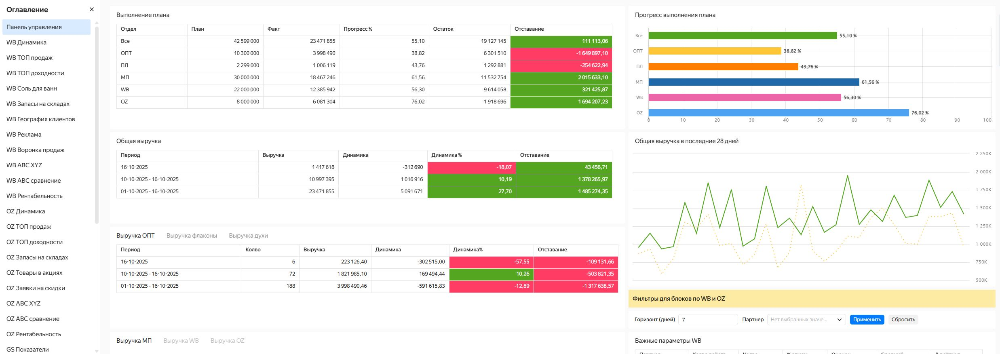 | 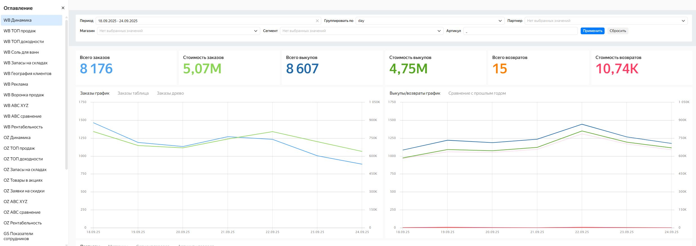 | 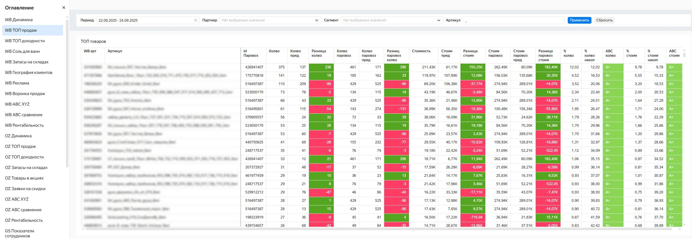 |
| Главная панель | Динамика продаж | ТОП продаж |
| 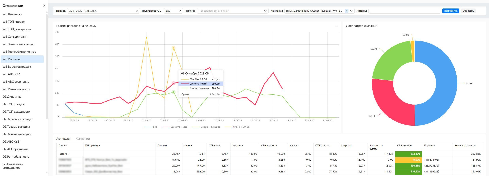 | 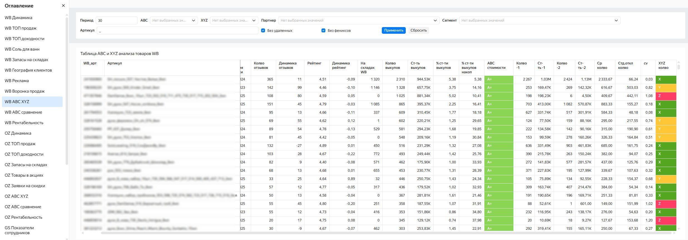 | 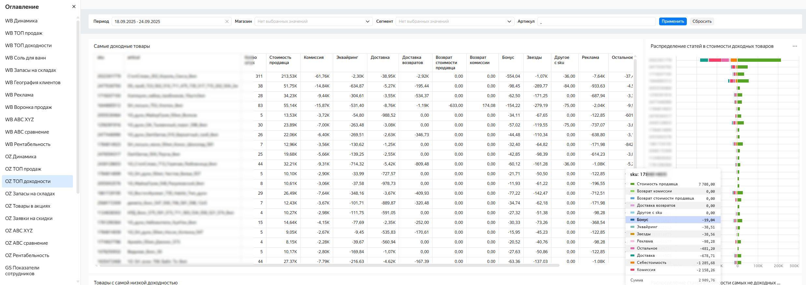 |
| Рекламные кампании | ABC / XYZ анализ | ТОП доходности |
| 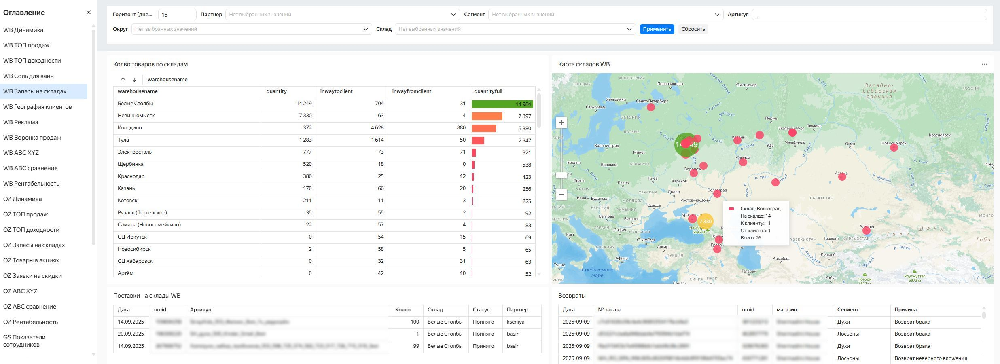 | 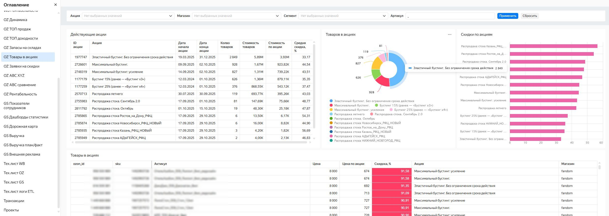 | 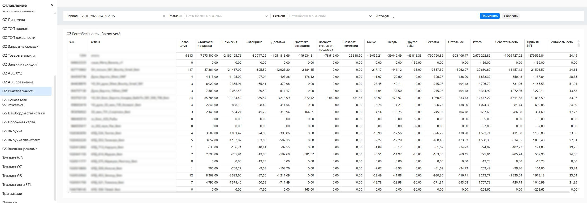 |
| Запасы на складах | Товары в акциях | Рентабельность |
| 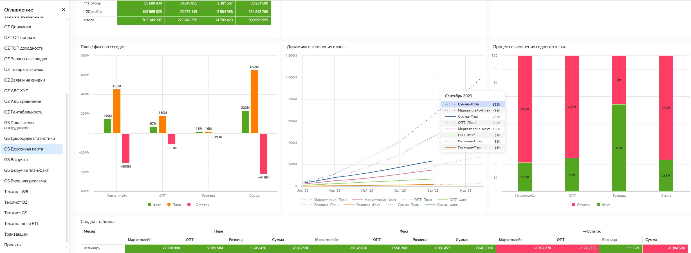 | 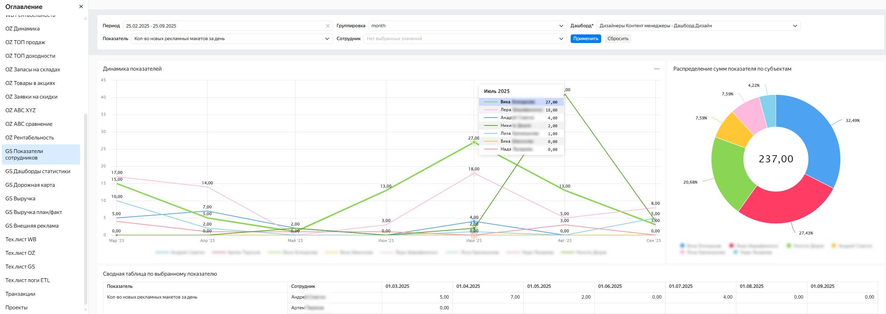 | 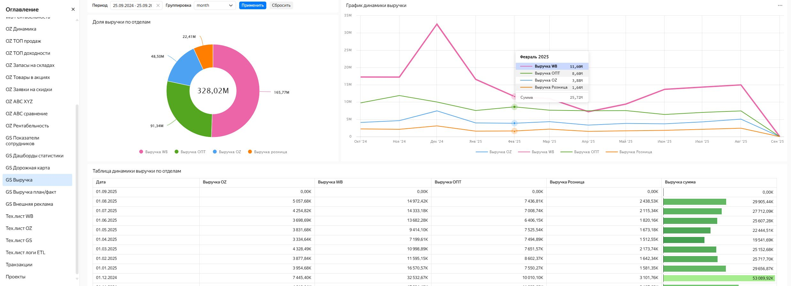 |
| План/факт | Показатели сотрудников | Выручка по отделам |
| 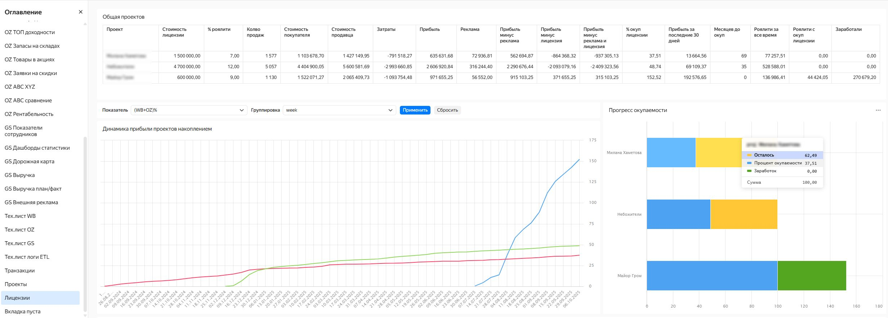 | 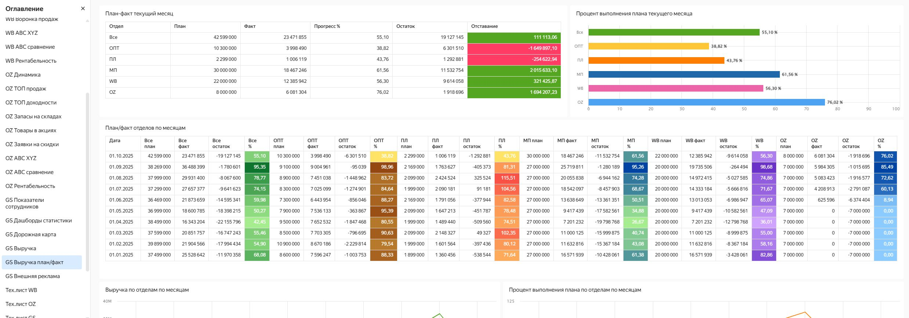 | 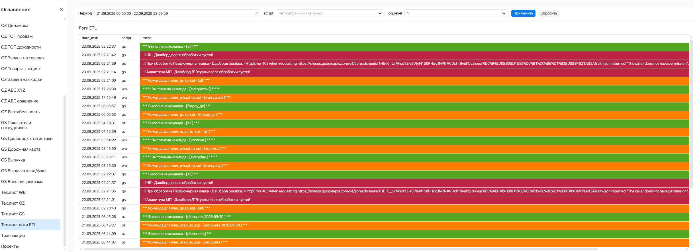 |
| Окупаемость лицензий | План/факт по отделам | Логирование ETL-скриптов |

---

Автор: Антон Суетов, [t.me/delffine](https://t.me/delffine)
